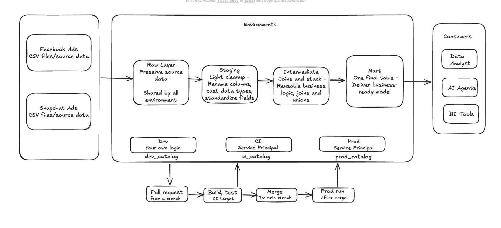
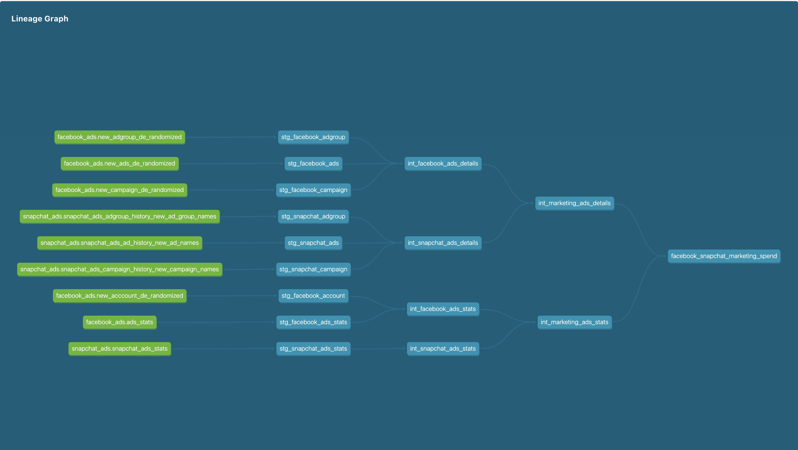
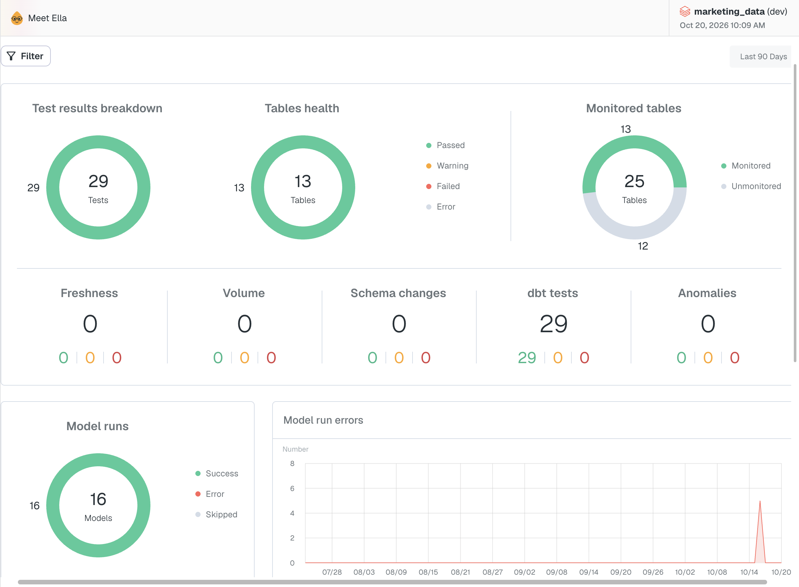

# Marketing Data Platform

A small, production-minded data platform that combines **Facebook Ads** and **Snapchat Ads** performance data into one governed, tested and documented model. It is built on **Databricks (Unity Catalog)** and **dbt**, monitored with **Elementary**, and deployed with **GitHub Actions** using a **Databricks Service Principal** for production.

The goal: marketers should no longer visit each advertising platform by hand. Analysts, BI tools and AI agents can query one trusted table and get consistent answers about spend, impressions, clicks and cost metrics, per platform, campaign and day.

---

## Table of contents

1. [Architecture](#architecture)
2. [Data sources](#data-sources)
3. [Model design](#model-design)
4. [Data quality](#data-quality)
5. [Materializations](#materializations)
6. [Environments](#environments)
7. [Production authentication](#production-authentication)
8. [Unity Catalog permissions](#unity-catalog-permissions)
9. [CI/CD](#cicd)
10. [Observability with Elementary](#observability-with-elementary)
11. [Documentation and lineage](#documentation-and-lineage)
12. [Setup](#setup)
13. [Answering the business questions](#answering-the-business-questions)
14. [Design decisions](#design-decisions)
15. [Status and known issues](#status-and-known-issues)

---

## Architecture



Data flows in one direction through four clearly separated layers:

| Layer | Where | What it does |
|---|---|---|
| **Raw** | `raw_marketing.ads_schema` | The Facebook and Snapchat tables exactly as loaded. dbt only reads from here. |
| **Staging** | dbt models `stg_*` | One model per raw table: renames columns, casts types, light cleanup. No joins. |
| **Intermediate** | dbt models `int_*` | Reusable logic: keep the latest version of each record, join names to metrics, make both platforms look the same, stack them. |
| **Mart** | dbt model `facebook_snapchat_marketing_spend` | The final table for analysts, BI tools and the AI agent. |

In Medallion terms: raw is bronze, staging and intermediate are silver, and the mart is gold. The layers are separate dbt folders and the environments are separate Unity Catalog catalogs.

Tooling around the pipeline: dbt tests protect the data, Elementary observes test results and model health, and GitHub Actions validates and deploys every change.

## Data sources

Both platforms have several tables, linked by ID columns. The raw tables were uploaded to `raw_marketing.ads_schema`.

| Platform | Raw tables |
|---|---|
| Facebook | `ads_stats`, `new_ads_de_randomized`, `new_adgroup_de_randomized`, `new_campaign_de_randomized`, `new_acccount_de_randomized` |
| Snapchat | `snapchat_ads_stats`, `snapchat_ads_ad_history_new_ad_names`, `snapchat_ads_adgroup_history_new_ad_group_names`, `snapchat_ads_campaign_history_new_campaign_names` |

How each platform links its tables:

- **Facebook:** stats → ad → campaign and ad group. The account table supplies the currency.
- **Snapchat:** stats → ad → ad group → campaign. The currency is on each stats row.

The two platforms name things differently (for example, Snapchat's stats table calls the ad key `ad_detail_id`, while its ad table calls it `ad_id`). The staging layer standardizes names so downstream users never see these differences.

## Model design

### Lineage



### Models and their grain

The grain is what one row represents. Every model has one, and tests enforce it.

| Model | Grain (one row per...) |
|---|---|
| `stg_snapchat_ads_stats` | ad, day, country (verified: 2,809 rows, unique on these three columns) |
| `stg_facebook_ads_stats` | ad, day |
| `stg_snapchat_ads` | ad (2,513 rows, 2,513 distinct ads) |
| `stg_snapchat_adgroup` | ad group per update. A history table: 267 rows for 264 ad groups |
| `stg_snapchat_campaign` | campaign (109 rows, 109 distinct campaigns) |
| `stg_facebook_ads`, `_adgroup`, `_campaign`, `_account` | record, with versions kept as in the source |
| `int_snapchat_ads_details`, `int_facebook_ads_details` | ad, using the latest version of every record |
| `int_snapchat_ads_stats` | ad, day, currency. Countries are summed to match Facebook |
| `int_facebook_ads_stats` | ad, day, with the account currency attached |
| `int_marketing_ads_details` | ad, per platform (both details models stacked) |
| `int_marketing_ads_stats` | ad, day, per platform (both stats models stacked) |
| `facebook_snapchat_marketing_spend` (mart) | ad, day, platform |

### The mart

One big table: the stats joined to the ad, ad group and campaign names, with these columns:

- **Keys:** `ad_id`, `ad_date`, `platform`. The key is the three together, because ad IDs come from two separate systems and are only unique per platform.
- **Descriptions:** `ad_group_id`, `campaign_id`, `ad_name`, `ad_group_name`, `campaign_name`, `channel_name`, `ad_detail_updated_at`.
- **Measures:** `ad_currency_code`, `ad_spend`, `ad_impressions`, `ad_clicks`.

### Platform differences and how they were resolved

- **Different names:** renamed to one standard in staging.
- **Country:** Snapchat reports per country, Facebook does not. No business question needs country, so Snapchat is summed across countries to reach the shared grain. This is a deliberate grain change, made in the intermediate layer and not in staging.
- **Currency:** it sits on Facebook's account table and on Snapchat's stats rows. It is attached to the stats (the numbers it describes) on both sides, and a currency column is kept so spend is never summed across different currencies by accident.
- **Account:** Facebook has account names, Snapchat does not, and no question needs them, so account columns are not carried into the final model.
- **History tables:** several details tables keep one row per update. The intermediate layer keeps only the latest version of each record (`row_number()` over the update timestamp, newest first), so joins cannot repeat rows and double-count spend.
- **Missing links:** 304 Snapchat ads have no ad group. None of them appear in the stats table, so no spend is affected. Their names stay null.

## Data quality

dbt tests protect the mart from bad data:

| Test | Where | What it protects |
|---|---|---|
| `unique_combination_of_columns` | Every model with a stated grain (mart: `ad_id`, `ad_date`, `platform`) | Catches duplicates and joins that multiply rows, which would double-count spend |
| `not_null` | Key columns | A key with a missing part cannot identify a row |
| `accepted_values` on `platform` | Mart and stacked models | Only `facebook` and `snapchat` get through |
| `accepted_range` (min 0) | `ad_spend`, `ad_impressions`, `ad_clicks` | Negative metrics indicate bad data |

Tests run in CI before a merge and again in the production run. Results are also recorded by Elementary.

Checks done by hand while designing the models, and the reasoning behind them:

- Compared row counts with distinct key counts on every table, which is how the history tables and the Snapchat country split were found.
- Checked that every ad in the stats tables finds its ad, ad group and campaign, and that the total spend is unchanged after every join.

## Materializations

| Layer | Materialization | Reason |
|---|---|---|
| Staging | `view` | Light renaming and casting over raw data. Always fresh, almost no cost. |
| Intermediate | `view` | Only feeds the mart. Nobody queries it directly, so storing it adds nothing. |
| Mart | `table` | It is what analysts, dashboards and the AI agent query repeatedly. Storing the result avoids re-running every join and the dedupe on each query. |

## Environments

The same dbt code runs in three environments. Only the catalog, the identity and the permissions change.

| Environment | Catalog | Who runs it | Authentication | Purpose |
|---|---|---|---|---|
| **dev** | `dev_catalog` | A developer, on their own machine | Personal access token | Experimenting freely |
| **ci** | `ci_catalog` | GitHub Actions, on every pull request | Service Principal (OAuth) | Proving a change builds and passes tests before it is merged |
| **prod** | `prod_catalog` (schema `marketing`) | GitHub Actions, after a merge to `main` | Service Principal (OAuth) | The trusted tables that consumers read |

All three read from the **shared raw catalog** `raw_marketing`, so a change that passes in CI sees the same input production will see, and the data is loaded only once. dbt never writes to it. The trade-off is that a bad raw load affects every environment at once.

Targets are defined in `profiles.yml`, and every value is read from an environment variable, so no real value is ever committed:

- My laptop uses a `profiles.yml` in `~/.dbt/` with the `dev` target.
- The pipeline uses `ci/profiles.yml`, which is committed and contains only `env_var` references, with the `ci` and `prod` targets.

## Production authentication

Production does not use a personal access token. It uses a **Databricks Service Principal**, `marketing-dbt-prod`.

A personal token belongs to a person. If that person changes role, leaves, or the token expires, production stops, and every action is recorded under their name. A Service Principal is a non-human identity, so production keeps running regardless of any individual, and the audit trail shows what the pipeline did.

How it logs in (OAuth 2.0, client credentials):

1. dbt sends the Service Principal's **client ID** (its Application ID) and **client secret** to Databricks.
2. Databricks checks them and returns a short-lived access token.
3. dbt uses that token for its queries, and requests a new one when it expires.

Details:

- The OAuth secret is created on the Service Principal's Secrets tab with a limited lifetime (100 days). It is shown once, kept outside the repository, and stored only in GitHub's secret store and in a local, git-ignored env file.
- Entitlements: workspace access and Databricks SQL access are on. **Admin access is off**, because the Service Principal needs to build tables, not manage the workspace.
- The Service Principal has **Can use** on the SQL warehouse.

## Unity Catalog permissions

Following the principle of least privilege, the Service Principal has exactly what dbt needs and nothing more. The statements are in [`sql/unity_catalog_grants.sql`](sql/unity_catalog_grants.sql).

| Object | Privileges | Why |
|---|---|---|
| `raw_marketing` (catalog) | `USE CATALOG` | Enter the raw catalog |
| `raw_marketing.ads_schema` | `USE SCHEMA`, `SELECT` | **Read only**. dbt never writes to raw |
| `prod_catalog` | `USE CATALOG`, `USE SCHEMA`, `CREATE SCHEMA`, `CREATE TABLE` | dbt creates its schema, then its tables and views |
| `ci_catalog` | the same four | The CI pipeline builds here |

The developer's own account also has `USE CATALOG`, `USE SCHEMA` and `SELECT` on `ci_catalog`, to inspect what CI built.

The grants were verified with `SHOW GRANTS` on each catalog and on the raw schema.

## CI/CD

```
Feature branch -> Pull request -> CI (dbt build) -> Merge to main -> Production run
```

Files:

| File | Purpose |
|---|---|
| `.github/workflows/ci.yml` | Runs on every pull request to `main` |
| `.github/workflows/deploy-prod.yml` | Runs after every push (merge) to `main` |
| `ci/profiles.yml` | dbt connection settings for the pipeline, env vars only |
| `sql/unity_catalog_grants.sql` | The permissions, kept as a record |

**CI workflow** (`ci.yml`): checks out the repo, installs the locked dependencies with uv, installs the dbt packages, runs `dbt build --target ci` (models and tests together), generates the dbt docs and keeps them as a downloadable artifact. Each pull request builds in its own schema, `ci_pr_<number>`, so runs never overwrite each other, and a newer run of the same pull request cancels the older one.

**Production workflow** (`deploy-prod.yml`): the same steps, with `dbt build --target prod`. It is never cancelled halfway, so a deploy is not left half finished. A merge is the only route to production, and CI has to pass before it.

**Secrets:** four values live in GitHub's repository secrets and are never written in a file:

`DATABRICKS_HOST`, `DATABRICKS_HTTP_PATH`, `DBX_ID_APPLICATION_ID`, `DBX_SECRET`


## Observability with Elementary

The [Elementary](https://www.elementary-data.com/) dbt package is installed and records test results, run history and model health in tables in the warehouse. The Elementary CLI generates an HTML report from them.



## Documentation and lineage

Sources, models, important columns and the business metrics all have descriptions, and every model states its grain.

Generate and open the docs locally:

```
cd marketing_data
uv run dbt docs generate
uv run dbt docs serve
```

The docs show the lineage from the raw sources to the final model, with descriptions and tests on each model. CI also generates the docs and saves them as a downloadable artifact on each run.

## Setup

### Requirements

- Python 3.12 and [uv](https://docs.astral.sh/uv/)
- A Databricks workspace with Unity Catalog and a SQL warehouse
- The raw tables in `raw_marketing.ads_schema`

### Steps

1. Clone the repo and install the dependencies:

   ```
   uv sync
   ```

2. Create the catalogs `raw_marketing`, `dev_catalog`, `ci_catalog` and `prod_catalog`, and load the raw tables into `raw_marketing.ads_schema`.

3. Create a `profiles.yml` in `~/.dbt/` with a `dev` target, and keep your values in a local env file that is **listed in `.gitignore`**. The dev target reads these variables:

   | Variable | Value |
   |---|---|
   | `DATABRICKS_HOST` | Workspace hostname, without `https://` |
   | `DEV_HTTP_PATH` | The SQL warehouse's HTTP path |
   | `DATABRICKS_PAT_TOKEN` | Your personal access token |
   | `DEV_CATALOG` | `dev_catalog` |
   | `DEV_SCHEMA` | A schema name for your dev builds |

4. Load the variables, install the dbt packages and check the connection:

   ```
   source <your env file>
   cd marketing_data
   uv run dbt deps
   uv run dbt debug
   ```

5. Build and test:

   ```
   uv run dbt build
   ```

### Running against production

Production is meant to run from the pipeline. To test the Service Principal from a local machine, set `DBX_ID_APPLICATION_ID`, `DBX_SECRET`, `PROD_HTTP_PATH`, `PROD_CATALOG` and `PROD_SCHEMA`, and run `dbt build --target prod`. Never commit these values.

### Repository layout

```
marketing-data-platform/
├── .github/workflows/      CI and production workflows
├── ci/profiles.yml         dbt connection settings for the pipeline
├── docs/images/            Diagrams used in this README
├── sql/                    Unity Catalog grants
├── marketing_data/         The dbt project
│   ├── models/
│   │   ├── staging/        facebook/ and snapchat/
│   │   ├── intermediate/
│   │   └── marts/
│   ├── dbt_project.yml
│   └── packages.yml
├── pyproject.toml
└── uv.lock
```

## Answering the business questions


## Design decisions

| Decision | Reason |
|---|---|
| One catalog per environment, shared read-only raw catalog | Environment separation as required, identical input everywhere, data loaded once |
| Layers as dbt folders, not separate catalogs | Keeps four catalogs instead of one per layer and environment |
| Staging stays one-to-one with raw | No joins or grain changes in staging, so it is easy to trust |
| Dedupe (latest version) in intermediate | Staging remains a faithful copy of raw, and the cleanup is a visible step |
| Left joins starting from the stats table | No spend row can be dropped by a missing name |
| Key includes `platform` | Ad IDs come from separate systems and could clash |
| Snapchat summed across countries | Shared grain with Facebook, and no business question needs country |
| Currency on the stats side | It describes the money, and the column prevents summing mixed currencies |
| Account columns dropped | Snapchat has none, and nothing requires them |
| One wide mart instead of fact and dimension tables | Consumers (analysts, BI, AI agent) can query it without joins, the data is small, and a fact and dimension split is the natural next step if it grows |
| Metrics null on zero denominators | A zero cost per click would wrongly say clicks were free |
| Service Principal with least privilege | Production independent of any person, and limited damage if credentials leak |
| Merge is the only route to production | CI is the gate, and nobody deploys by hand |

## Status and known issues

**Working and verified:**

- Raw data loaded into `raw_marketing.ads_schema`
- Staging, intermediate and mart models build in dev and in production
- Production build run with the Service Principal (OAuth), with models created in `prod_catalog`
- Unity Catalog grants applied and verified with `SHOW GRANTS`
- dbt docs and lineage generated
- Elementary working

**Known issues and next steps**:

- [ ] GitHub Actions CI run fails at the connection step** (`http_path` arrives empty). The workflow is found and runs, installs dependencies and parses the whole project, so the structure is sound. Next step: check that the secret `DATABRICKS_HTTP_PATH` exists with that exact name, as a repository secret, and re-run.
- [ ] Answering business questions not done